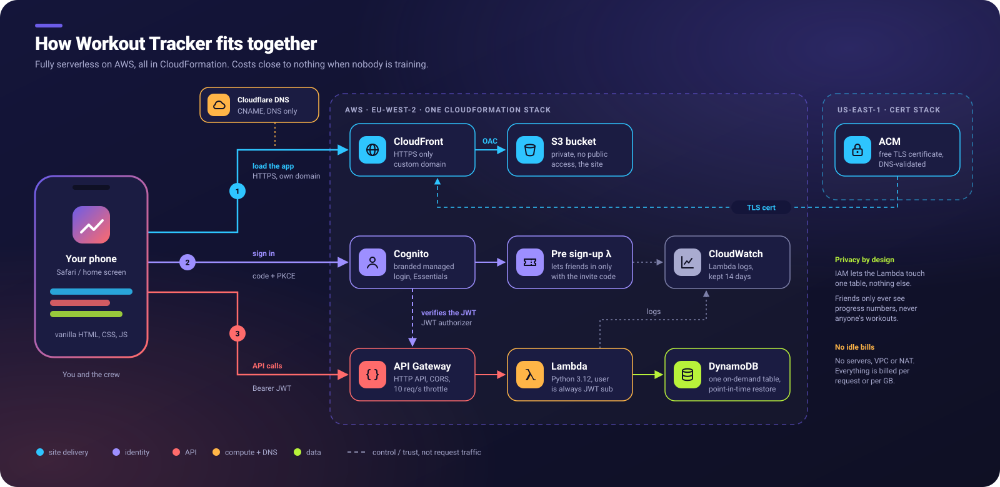

# Workout Tracker

I'm on a fat loss journey. Anyone who's done one knows the scales are a
pretty miserable way to measure it: they bounce around day to day, and
some weeks they barely move even when everything else is going right.
What I actually wanted to see was the stuff that *was* changing. Am I
lifting more than I was a month ago? Am I turning up as often as I
think I am? Is the work adding up?

My workouts were scattered across notes on my phone, half-remembered
numbers and the odd screenshot. There was no way to look back and see
progress, and no easy way to plan the week ahead either. The apps I
tried were either cluttered, wanted a subscription, or wanted all my
data on someone else's servers.

So I built my own. It's a small, phone-first web app that does four
things:

- **Calendar:** see which days I trained (a filled dot) and which I've
  planned (a hollow dot), plan future sessions, and open any past one.
- **Workout:** a big Start Workout button for the gym. Type each
  exercise, add sets with reps and weight, hit Finish. If my phone locks
  or the page refreshes mid-session, the draft is still there.
- **Progress:** a chart per exercise, showing estimated one-rep max,
  total volume or top set weight over time. This is the bit that keeps
  me going on the weeks the scales don't.
- **Crew:** a few friends train alongside me. We can see each other's
  goals, cheer each other on, run friendly challenges that measure
  progress against each person's own starting point, and compare our
  lines on the chart. Friends only ever see progress numbers, never
  anyone's actual workouts.

Along the way it picked up a landing page, its own domain
(workout.cybercourtney.uk), a login page that matches the app, personal
record celebrations and a shareable image of each workout.

**It's also another hands-on AWS project.** I'm building my cloud skills
by making real things I actually use, and a workout tracker for me and a
few friends is a nice problem to get right: it needs a proper login, it has
to keep my data safe and private, and it should cost close to nothing
to run, because it sits idle for most of the day. That's why it's fully
serverless with on-demand billing, why login is Cognito rather than
something homemade, and why every piece of infrastructure lives in one
CloudFormation template.

## Build your own

I built this with Claude Code from a single detailed prompt, then
extended it step by step with three more. All four are in
**[docs/PROMPT.md](docs/PROMPT.md)**, with my personal details swapped
out for placeholders, so you can paste them into Claude Code and build
your own copy in your own AWS account.

## Skills demonstrated

**AWS:** CloudFormation · Cognito (managed login with custom branding,
authorization code + PKCE, invite-only sign-up via a Pre sign-up Lambda
trigger) · API Gateway HTTP API (JWT authorizer) · Lambda · DynamoDB
(on-demand, TTL) · S3 · CloudFront (Origin Access Control) · ACM
(custom domain, DNS validation) · IAM (least privilege)

**Practices:** infrastructure as code, least-privilege IAM scoped to one
table, the user always taken from the verified JWT and never from the
request, input validation with clear 4xx errors and no leaked stack
traces, unit tests including a check that one user can't read another
user's data, and a design that costs close to zero when idle.

**Frontend:** vanilla HTML, CSS and JavaScript with no framework, no
libraries and no CDN. The charts are hand-drawn inline SVG (the crew
chart tells people apart by marker shape and name, not just colour), the
share image is drawn with the Canvas API, the illustration is original
SVG, and every text colour is checked against WCAG AA. Dark by default,
with a light mode in Settings.

## How it works



Three things happen when I open the app on my phone:

1. **Load the app.** Cloudflare DNS points my domain at CloudFront, which serves the site from a private S3 bucket over HTTPS. The certificate comes from ACM in us-east-1, because that's the only region CloudFront accepts.
2. **Sign in.** Cognito's managed login (themed to match the app) handles passwords, using the authorization code flow with PKCE. When a friend signs up, a small Pre sign-up Lambda checks their invite code first.
3. **Log and read workouts.** The app calls an API Gateway HTTP API with its token. The JWT authorizer checks it against Cognito before anything runs, then a Python Lambda reads or writes the one DynamoDB table.

| Piece | What it does | Idle cost |
|---|---|---|
| S3 + CloudFront | Serves the static frontend. Bucket is private; only CloudFront can read it. HTTPS only. | ~$0 (pennies of storage) |
| Cognito user pool (Essentials tier) | Branded managed login. Sign-up only with the crew invite code (or admin-created). | $0 (free under 10,000 monthly users) |
| Pre sign-up Lambda (`backend/presignup.py`) | Rejects sign-ups without the right invite code. | $0 when idle |
| HTTP API + JWT authorizer | Routes below; rejects requests without a valid Cognito access token. CORS allows only the CloudFront domain. Throttled to 10 req/s. | $0 when idle, pay per request |
| Lambda (`backend/handler.py`) | Validates input and reads/writes the table. User is always the JWT `sub`; crew routes return aggregates only. IAM allows only Query/GetItem/PutItem/DeleteItem on this one table. | $0 when idle |
| DynamoDB | One on-demand table, point-in-time recovery on, TTL for old crew feed items, retained if the stack is deleted. | ~$0 (pennies of storage + PITR) |
| CloudWatch Logs | Lambda logs, kept 14 days. | ~$0 |
| ACM certificate (optional, us-east-1) | TLS for the custom domain. | $0 |

No VPC, NAT gateway, provisioned capacity or anything billed by the hour.

### Data model

One item per workout (crew items are described in [docs/SOCIAL_DESIGN.md](docs/SOCIAL_DESIGN.md)):

- `PK` = `USER#<cognito sub>`
- `SK` = `WORKOUT#<YYYY-MM-DD>#<id>`
- attributes: `id`, `date`, `status` (`planned` | `completed`), `exercises[]` of `{name, sets[] of {reps, weight}}`, `updatedAt`

Weights are stored in kg. The kg/lb setting only changes what the app displays.

### API

| Route | Notes |
|---|---|
| `GET /workouts?from=YYYY-MM-DD&to=YYYY-MM-DD` | Inclusive date range, both required |
| `POST /workouts` | Creates a workout; the server assigns the id |
| `PUT /workouts/{id}` | Replaces a workout (can move its date, e.g. starting a planned workout today) |
| `DELETE /workouts/{id}` | |

Crew routes (`/me`, `/goals`, `/crew`, `/crew/series`, `/crew/cheers`, `/competitions`) and how each one keeps workouts private are in [docs/SOCIAL_DESIGN.md](docs/SOCIAL_DESIGN.md).

Validation: dates must be real `YYYY-MM-DD` dates, status must be `planned` or `completed`, reps and weight must be non-negative numbers, at most 30 exercises with 20 sets each, bodies at most 100 KB. Errors return a 4xx with `{"error": "..."}`; unexpected errors return a generic 500 and are logged, never echoed.

## Project layout

```
infra/template.yaml        CloudFormation for every resource
backend/handler.py         Lambda function
backend/presignup.py       Cognito Pre sign-up trigger (invite code check)
backend/test_handler.py    Unit tests (unittest + unittest.mock)
backend/test_crew.py       Crew tests: isolation, privacy, invite code, goal/challenge maths
infra/certificate.yaml     ACM certificate for the custom domain (us-east-1)
frontend/                  index.html, styles.css, app.js, crew.js, share.js, config.js (blank; filled at deploy), manifest + icons
scripts/deploy.sh          Validates, deploys, uploads code and site; echoes every command
scripts/deploy-certificate.sh  Creates the us-east-1 certificate and prints its DNS validation record
tests/share-render.html    Browser test for the share image
docs/architecture.svg      The diagram above
docs/PROMPT.md             The prompts I used to build it with Claude Code
docs/SOCIAL_DESIGN.md      Crew design and privacy rules
docs/contrast.md           WCAG contrast checks for every text colour
docs/screenshots/          Screenshots of each screen
docs/share-samples/        Sample share images
```

## Features

- **Landing page**: signed-out visitors see a landing page instead of being sent straight to the login; Sign in and "Have an invite? Join" start from there.
- **Login page**: Cognito's managed login, themed to match the app (`LoginBranding` in the template, artwork in `infra/branding/`).
- **Calendar**: month grid; filled dot = completed, hollow dot = planned. Tap a day to see, add, edit, delete, start, share or repeat its workouts.
- **Workout**: type exercises as you go, with autocomplete and a "Last time" line under each exercise showing what you did before. The draft survives a refresh.
- **Progress**: line chart per exercise (estimated 1RM, volume or top set).
- **Personal records**: when you finish, any set that beats your previous best estimated 1RM or top weight for that exercise gets a 🏆 toast. Worked out on the phone from your history; nothing extra is stored.
- **Share**: any completed workout (and the "Workout saved" sheet after Finish) can be shared as a 1080×1350 PNG drawn in the browser with the Canvas API. It opens the iPhone share sheet, or saves the file where sharing isn't available. PR sets get a "PR" badge.
- **Repeat**: copies a past workout's exercises into a new draft for today. Last time's numbers show as greyed placeholders, so nothing counts until you type it.
- **Crew**: shared goals with progress rings, cheers, friendly challenges ("Biggest improvers") and a Me | Crew chart. See [Crew](#crew-friends-training-together) below.

## Run the tests

```bash
cd backend && python3 -m unittest -v
```

Share image: serve the repo root (`python3 -m http.server`) and open `/tests/share-render.html`. It renders a short workout, a 30-exercise workout and the API's worst case (30 exercises × 20 sets), and checks each is exactly 1080×1350 with no text outside its box. The page title reads PASS or FAIL. Sample output is in `docs/share-samples/`.

## Deploy

Prerequisites: AWS CLI v2 signed in to the account you want to use, and `zip`.

### First deploy (cloudfront.net URL only)

`scripts/deploy.sh` runs these in order, printing each command first:

1. `aws sts get-caller-identity`: confirm which account you're about to deploy to.
2. `aws cloudformation validate-template --template-body file://infra/template.yaml`
3. `aws cloudformation deploy --stack-name workout-tracker --template-file infra/template.yaml --capabilities CAPABILITY_IAM --no-fail-on-empty-changeset [--parameter-overrides ...]` (first run takes about 5 minutes, mostly CloudFront)
4. `aws cloudformation describe-stacks` to read the outputs (site URL, API URL, user pool ID, client ID, Hosted UI domain, bucket, distribution, function).
5. Zip `backend/handler.py` and `aws lambda update-function-code`, then `aws lambda wait function-updated`.
   It also uploads `backend/presignup.py` to the Pre sign-up Lambda the same way.
6. Copy `frontend/` to a temporary folder and write the outputs into that copy's `config.js`.
7. `aws s3 sync <temporary folder>/ s3://<bucket>/ --delete`, `aws s3 cp` for `manifest.webmanifest` (sets its content type), then `aws cloudfront create-invalidation --paths "/*"`.

The deploy step reads the stack's current parameters first (`describe-stacks`) and asks for the crew invite code if none is set yet. It's masked as `InviteCode=****` in the printed commands.

```bash
aws sso login --profile <your-profile>        # only if your profile uses SSO
AWS_PROFILE=<your-profile> AWS_REGION=eu-west-2 ./scripts/deploy.sh
```

`frontend/config.js` in the repo stays blank: the deployment's IDs only ever go into the temporary copy, so there's nothing to accidentally commit.

### Custom domain (e.g. workout.example.com)

CloudFront only accepts certificates from **us-east-1**, while the app stack lives in eu-west-2. So the certificate is a separate tiny stack (`infra/certificate.yaml`, an ACM certificate, free) deployed to us-east-1, and its ARN is passed to the main stack as a parameter. The main stack then adds the domain as a CloudFront alias, adds it to the Cognito callback and sign-out URLs and the API's CORS origins, and keeps the cloudfront.net URL working.

Deploy order:

1. **Certificate (us-east-1).**
   ```bash
   AWS_PROFILE=<your-profile> DOMAIN_NAME=workout.example.com ./scripts/deploy-certificate.sh
   ```
   This runs `aws cloudformation validate-template` and `aws cloudformation create-stack --region us-east-1 --stack-name workout-tracker-certificate ...`, then prints a **validation CNAME**. If your DNS isn't in Route 53 (e.g. Cloudflare), add that CNAME at your DNS provider now, set to *DNS only* (not proxied), and leave it there permanently so the certificate renews itself. The script waits (`aws cloudformation wait stack-create-complete`) until ACM sees the record, usually a few minutes, then prints `CERTIFICATE_ARN=...`. With a Route 53 zone, add `HOSTED_ZONE_ID=<zone id>` and validation is automatic.
2. **App stack with the domain.**
   ```bash
   AWS_PROFILE=<your-profile> DOMAIN_NAME=workout.example.com CERTIFICATE_ARN=<arn from step 1> ./scripts/deploy.sh
   ```
   Add `HOSTED_ZONE_ID=<zone id>` only if the domain's DNS is in Route 53; the stack then creates A and AAAA alias records itself.
3. **Site DNS record** (DNS outside Route 53 only). At your DNS provider add a CNAME from the domain to the `DnsTarget` value the deploy prints (the `xxxx.cloudfront.net` name), *DNS only*.

Later plain `./scripts/deploy.sh` runs keep the domain: parameters you don't set keep the stack's current values.

## Crew (friends training together)

Up to ~15 friends share one crew: personal goals the crew can follow, friendly challenges measured against each person's own starting point, cheers, and a **Me | Crew** toggle on the Progress chart. Design and privacy rules: [`docs/SOCIAL_DESIGN.md`](docs/SOCIAL_DESIGN.md). In short, friends only ever see display names, colours, chart numbers, goal progress and challenge results. Never workouts or sets. Anyone can turn off **Share my progress with the crew** in Settings.

### Invite code: set or rotate

Sign-up is invite-only. The code is a `NoEcho` CloudFormation parameter (`InviteCode`, 12+ characters), so it never appears in source, outputs or the deploy log.

- **First crew deploy:** `scripts/deploy.sh` asks for it (hidden input).
- **Rotate:** `ROTATE_INVITE=1 AWS_PROFILE=<your-profile> ./scripts/deploy.sh` and type the new code. Existing accounts are unaffected; only new sign-ups need the new code.
- Pick something long and random (e.g. `python3 -c "import secrets; print(secrets.token_urlsafe(12))"`) and share it privately.

### How a friend joins

1. Send them the site link and the invite code.
2. On the landing page they tap **Have an invite?**, enter email, a password (12+ characters, upper and lower case, a number) and the invite code.
3. Cognito emails a 6-digit code; they enter it to confirm their email.
4. They tap **Sign in**, log in, and choose a display name. They get the first free crew colour and a marker shape, and can change the colour in Settings.

Sign-ups without the right code are rejected by the Pre sign-up Lambda (`backend/presignup.py`), including attempts through Cognito's own sign-up page.

## Create your login (admin)

Admin-created accounts (like the first one) don't need the invite code. To create one yourself, use the `UserPoolId` printed at the end of the deploy:

```bash
aws cognito-idp admin-create-user \
  --profile <your-profile> --region eu-west-2 \
  --user-pool-id <UserPoolId> \
  --username you@example.com \
  --user-attributes Name=email,Value=you@example.com Name=email_verified,Value=true \
  --desired-delivery-mediums EMAIL
```

Cognito emails you a temporary password. Open the site URL, sign in with it, and the Hosted UI asks you to choose your real password (at least 12 characters, with upper case, lower case and a number). Your password never goes through the terminal or this code.

On iPhone, open the site in Safari and use Share → Add to Home Screen. It gets the app icon and opens full screen (`manifest.webmanifest`, `icon-*.png`, rendered from `frontend/icon.svg`). There is no offline caching.

## Tear down

```bash
aws cloudformation delete-stack --stack-name workout-tracker --profile <your-profile> --region eu-west-2
```

The DynamoDB table is kept (DeletionPolicy: Retain) so your history survives; delete it by hand in the console if you really want it gone. The S3 bucket must be emptied before the stack can delete it.

## Licence

[MIT](LICENSE). Build your own, change it, make it yours.
